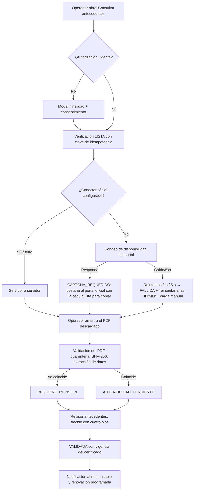

# Diagnóstico de SIGECOP — 27/10/2026

Auditoría breve antes del cierre de 14 días. Fuentes: código en `main` (`1faa2f4`), `doc/constitution.md`, `doc/Requerimientos.docx` v0.1, `odd/tasks/*.md`, memoria de sesiones anteriores y 17 capturas del sistema anterior (COSED/GESCON, `doc/Software actual/`). **No hay videos en `doc/`** todavía.

Leyenda: ✅ terminado y probado · 🟡 incompleto · 🔴 defectuoso · ⬜ no existe / sin especificar.

---

## 1. Estado actual

- Stack: Django 5.2 + HTMX + Tailwind v4, Celery/Redis (declarado), SQLite en desarrollo. Monolito modular con 9 apps (`core → identidad → empresas → personas → cumplimiento → antecedentes → accesos → trabajos`, más `portal`).
- Calidad: 352 pruebas OK, ruff y bandit limpios, CI en verde (check, test, ruff, bandit, pip-audit, CSS).
- Repositorio: solo `main`, sin cambios pendientes ni PRs abiertos.

## 2. Inventario de módulos

| Módulo | Estado | Evidencia / qué falta |
|---|---|---|
| Antecedentes (Ministerio del Interior) | ✅ | 14 estados, consentimiento, cuatro ojos, consulta asistida, PDF real, vigencia, API `/api/v1/...`. Falta T9: Función Judicial, firma criptográfica (pyHanko), cifrado de campos. |
| Cuentas de portal (empresa/persona) | ✅ | Enlace de activación de 72 h, portal de solo lectura, middleware de denegación por defecto. |
| Empresas | 🟡 | Crear/editar y enviar acceso. Falta: contratos en UI, suspender/reactivar con motivo (RF-013), historial legal (RF-012), detalle/expediente. |
| Personas | 🟡 | Crear/editar/asignar. Faltan campos del sistema anterior (nacionalidad, domicilio, teléfono de emergencia, posición) y expediente cronológico (RF-023). |
| Cumplimiento documental | 🟡 | Catálogo, carga y revisión una por una. Falta: aprobación masiva, "Nuevo/Actualización", fecha de emisión al aprobar, alertas previas (RF-033) agendadas. |
| Permisos de ingreso | 🔴/🟡 | **Se aprueban solos** si la persona está habilitada (`accesos/services.py:81`); el sistema anterior tenía "Pendiente de aprobación". Un permiso es para una persona; el anterior agrupaba cuadrillas. |
| Permisos de trabajo | 🟡 | Máquina de estados. Falta: tipos de trabajo, actividades, herramientas y equipos, orden de trabajo, emergencia, cuadrilla. |
| Garita | ✅ | Consulta por código sin datos sensibles. |
| Alertas | 🟡 | Modelo y lista, exportación CSV. Los jobs diarios existen como funciones pero **no están agendados** (Fase 9). |
| **Roles y permisos internos** | 🔴 | **Solo antecedentes valida roles.** El resto de vistas internas solo filtra por organización: cualquier usuario con *cualquier* rol activo (incluida garita) puede crear empresas, aprobar documentos o solicitar ingresos. Contradice "mínimo privilegio" y AC-002/AC-003. |
| Usuarios internos | ⬜ | Solo desde el admin de Django. No hay pantalla para invitar usuarios internos ni asignar roles/alcances. |
| Alcance por empresa/instalación | ⬜ | `AlcanceAsignado` existe pero ninguna vista lo usa (gestor "solo sus empresas"). |
| Reportes con filtros + PDF/Excel | ⬜ | Solo `alertas.csv`. |
| Visitas administrativas | ⬜ | No existe. |
| Cursos/evaluaciones, Alcocheck, Faltas, Comunicados | ⬜ | No existen; además, sin especificar. |
| MFA (RF-001), auditoría consultable en UI (RF-071), derechos ARCO (RF-073) | ⬜ | Pendientes de endurecimiento. |

## 3. Hallazgos del sistema anterior (capturas)

Menú: Comunicados · Documentos · Informes · Procesos · Excelencia Operacional · Mantenimiento · General.

| Pantalla anterior | Qué hace | En SIGECOP |
|---|---|---|
| Inicio "Por hacer" | Lista "Documentos por aprobar" agrupados por compañía | 🟡 el panel solo muestra totales |
| Documentos — bandeja | Tabla con casilla para selección masiva, Gestión (Nuevo/Actualización), fecha de emisión editable, Aprobar/Rechazar por fila, ver y adjunto | 🟡 revisión una por una |
| Procesos → Solicitud de ingreso | Varias personas por solicitud; orden de trabajo, anfitrión de la empresa cliente con su correo, planta, trabajo, actividades, herramientas y equipos, tipo de trabajo, "Sin documentos", emergencia, caducidad de antecedentes por trabajador; filtros por contratista, planta, estado y fechas; paginado | 🟡 permiso individual, sin estos campos |
| Procesos → Visitas administrativas | Solicitante, planta, fechas, motivo, lista de participantes (nombre, correo, cédula, compañía, RUC) | ⬜ |
| Informes (6) | Cursos, Documentos trabajadores, Información trabajadores, Solicitud de ingreso, Reportes de antecedentes, Informes de Alcocheck; cada uno con filtros, búsqueda, "Descargar informe" y "Descargar a Excel" | ⬜ |
| Información trabajadores | Estado del trabajador, estado de documentos, estado de evaluaciones, estado de antecedentes, nacimiento, RUC, tipo de empresa, posición, nacionalidad, correo, domicilio, teléfonos, cursos y documentos | 🟡 faltan campos y vista consolidada |
| Reporte de antecedentes | Empresa, trabajador, Gestión, estado, fecha de validación, caducidad, evidencia, revisor | 🟡 bandeja sí, reporte exportable no |
| Excelencia operacional → Histórico de ingresos a planta | Entradas y salidas por trabajador, planta y fecha | 🟡 `EventoAcceso` existe, falta el reporte |
| Mantenimiento (12) | Tipo de trabajo, Plantas, Parámetros generales, Perfiles por usuario, Usuarios internos, Oportunidades evaluación externa, Preguntas, Parámetros de evaluación, Tipos de pregunta, Comunicados generales, Faltas, Documentos | 🟡 plantas y documentos sí; el resto no |
| General | Idioma (Español/English) y Salir | 🟡 solo salir |

Las capturas contienen cédulas, nombres y correos reales: siguen fuera de Git (`doc/` está ignorada) y no se copian a pruebas ni fixtures.

## 4. Herramientas realmente disponibles

| Herramienta | Estado real |
|---|---|
| Lectura de imágenes (capturas) | ✅ usada en esta auditoría |
| Gemini para analizar videos (`fetch_content` con archivo local o YouTube) | 🟡 hay una clave Gemini configurada en `~/.pi/agent/web-search.json`; **no probada todavía**. `ffmpeg` y `yt-dlp` **no están instalados**, así que no puedo extraer fotogramas; el análisis del video completo depende de Gemini. |
| Búsqueda web (Exa) | ✅ usada para la investigación de antecedentes |
| Context7 (docs de librerías) | ✅ |
| GitHub CLI | ✅ (`C:\Program Files\GitHub CLI\gh.exe`) |
| Subagentes (explorar, implementar, verificar) | ✅ |
| Revisión nativa (RDD) y GGA en pre-commit | ✅ |
| Skill "de Google" específica | ⬜ no hay ninguna instalada; lo más cercano es Gemini vía `fetch_content`. |

**Para analizar los videos necesito:** que los copies a `doc/videos/` (MP4) o me pases enlaces de YouTube no listados. Si son locales, conviene instalar `ffmpeg` (`winget install Gyan.FFmpeg`) para extraer fotogramas de pantallas puntuales.

## 5. Propuesta para antecedentes penales y judiciales

### 5.1 Investigación, en el orden pedido

| Alternativa | Hallazgo | Estado |
|---|---|---|
| **Integración oficial** | El Ministerio del Interior emite el certificado solo por su portal web, gratis y con cédula (gob.ec). La DINARP/DINARDAP ofrece interoperabilidad (SINARDAP, servicios web) mediante oficio, convenio y acta de credenciales; está pensada para instituciones. **No encontré evidencia pública** de que una empresa privada pueda consultar antecedentes penales por ese canal. La Función Judicial publica la consulta e-SATJE (búsqueda pública por cédula, nombre o número de proceso), sin una API documentada para terceros. | No confirmado: requiere oficio a DINARP y al Consejo de la Judicatura |
| Proveedor autorizado | Hay servicios privados que dicen consultar más de 15 fuentes por API (p. ej. Ecuachecks, Tusdatos). Hace falta verificar su base jurídica, contrato, retención y evidencia de origen antes de enviarles una sola cédula. | No evaluado: decisión legal y comercial |
| **Automatización asistida** | Ya está implementada y probada: SIGECOP abre el portal oficial en una pestaña nueva, con la cédula lista para copiar; el operador resuelve el CAPTCHA, descarga el PDF y lo arrastra a SIGECOP. | ✅ en `main` |
| **Recepción automatizada** | Ya está implementada: validación del PDF, cuarentena, extracción de datos, coincidencia de identidad, SHA-256, vigencia, revisión con cuatro ojos y renovación. | ✅ en `main` |
| **Excepciones** | Ya está implementada: máximo dos reintentos con espera incremental, circuit breaker por proveedor con "reintentar a las HH:MM", `FALLIDA` (nunca favorable) y carga manual siempre disponible. | ✅ en `main` |

**Aviso legal (ya se había marcado):** el certificado indica "Queda prohibido tanto para el sector público como privado exigir como requisito el Certificado de Antecedentes Penales" (Decreto 1166). El director o el área legal deben confirmar la base jurídica antes de producción.

### 5.2 ¿Modal propio, redirección o servidor a servidor?

| Opción | Viable | Qué automatiza de verdad |
|---|---|---|
| Modal o ventana propia de SIGECOP que captura los datos | ✅ | Registra finalidad, consentimiento y cédula, crea la verificación idempotente y prepara la consulta. **No puede** mostrar el portal oficial dentro de un iframe ni enviarle un POST: el portal exige CAPTCHA y aceptar términos, y enviarle datos desde nuestro servidor sería eludir sus controles. |
| Redirección o pestaña al portal oficial | ✅ (ya existe) | El operador hace el paso humano en el sitio oficial; SIGECOP espera el PDF. |
| Servidor a servidor | Solo con un convenio oficial (DINARP o Consejo de la Judicatura) o un proveedor autorizado | Todo el flujo, sin intervención humana. Hoy no está demostrado. |

### 5.3 Flujo propuesto

### 5.4 Qué se automatiza, qué es humano y qué no está confirmado

- **Automatizado (ya en `main`):** idempotencia, sondeo del portal, reintentos y circuit breaker, extracción del PDF, coincidencia de identidad, vigencia, renovación programada y auditoría.
- **Humano:** CAPTCHA y términos del portal, descarga del PDF y decisión final con cuatro ojos.
- **No confirmado:** API oficial o convenio, proveedor privado, validación criptográfica de la firma (el PDF real tiene firma; pyHanko está en T9), consulta automática a la Función Judicial y base jurídica.

### 5.5 Esfuerzo y versión mínima viable

- **MVP dentro del plazo (2 días):** Función Judicial en modo asistido, con la misma pestaña al portal y la carga de una captura o PDF de la búsqueda e-SATJE como evidencia. Un hallazgo pasa siempre a revisión manual y nunca es un resultado automático. Además, notificación por correo al revisor cuando llega un PDF.
- **Firma criptográfica con pyHanko (1–2 días):** depende de la cadena de certificados de la entidad emisora (por confirmar).
- **Integración oficial:** no se estima. Depende del trámite con la DINARP, que puede tardar semanas, y queda fuera de los 14 días.

## 6. Plan de 14 días

Prioridad: P0 = bloqueante para entregar · P1 = importante · P2 = puede esperar. Cada día termina con pruebas verdes y un commit revisable.

| Día | Prioridad | Entregable | Depende de | Criterio de aceptación |
|---|---|---|---|---|
| 1 | P0 | Matriz de permisos por rol, con denegación por defecto en todas las vistas internas | — | Garita recibe 403 en empresas, personas, documentos y trabajos; cada rol hace solo lo de su descripción; pruebas por rol |
| 2 | P0 | Pantalla de usuarios internos: invitar por correo, asignar rol y alcance, desactivar | Día 1 | Admin cliente invita y el usuario activa su cuenta con enlace de 72 h; nadie asigna roles fuera de su organización |
| 3 | P0 | Alcance del gestor por empresa (`AlcanceAsignado`) | Día 1–2, respuesta del director (P2) | Un gestor no ve ni edita otra empresa (AC-002) |
| 4 | P0 | Permisos de ingreso con aprobación humana ("Pendiente de aprobación") | Respuesta del director (P8) | Ningún permiso queda aprobado sin un aprobador registrado |
| 5 | P0 | Jobs diarios agendados (Celery beat) + correos de vencimiento, observación, aprobación y rechazo | — | Las pruebas con reloj simulado generan una sola alerta y un solo correo (idempotente) |
| 6 | P1 | Bandeja documental: selección masiva, Gestión Nuevo/Actualización, fecha de emisión | — | Aprobar 10 documentos en una acción crea 10 revisiones auditadas |
| 7 | P1 | Inicio "Por hacer": documentos por aprobar agrupados por compañía | Día 6 | Los conteos coinciden con la bandeja y respetan el rol |
| 8 | P1 | Reportes con filtros + Excel: documentos de trabajadores, información de trabajadores, antecedentes (sin resultado para quien no tenga rol) | Día 1 | Exportar queda auditado (RN-009); garita no exporta |
| 9 | P1 | Reportes: solicitudes de ingreso e histórico de ingresos a planta | Día 4, 8 | Filtros por contratista, planta, estado y fechas |
| 10 | P1 | Solicitud de ingreso con cuadrilla y datos del trabajo (orden de trabajo, anfitrión, actividades, herramientas, emergencia) | Día 4, respuesta del director (P9) | Una solicitud evalúa la habilitación de cada integrante por separado |
| 11 | P1 | Visitas administrativas | Respuesta del director (P10) | Las visitas no exigen expediente de contratista, pero sí quedan registradas en garita |
| 12 | P1 | Antecedentes judiciales asistidos (MVP 5.5) | — | Un hallazgo siempre pasa a revisión; un fallo nunca es favorable |
| 13 | P1 | Persona: campos faltantes y expediente cronológico (RF-023) | — | La línea de tiempo muestra documentos, permisos, verificaciones (sin resultado) y accesos |
| 14 | P0 | Verificación independiente, corrección de errores, actualización de la constitución, guía de prueba manual | Todo | Suite verde, checklist de aceptación AC-001..AC-010 |

**P2 (después del plazo, salvo que sobre tiempo):** cursos y evaluaciones, Alcocheck, faltas, comunicados generales, idioma inglés, MFA, auditoría consultable en UI, derechos ARCO, firma con pyHanko, cifrado de campos, contratos y suspensión de empresas con impacto calculado.

**Riesgos:** respuestas del director tardías (mitigación: los días 1, 2, 5, 6, 7, 8, 12 y 13 no dependen de él); videos sin entregar (seguimos con las capturas); volumen de datos y servidor de producción sin definir; base legal de antecedentes.

## 7. Primera tarea

**Día 1 — matriz de permisos por rol.** Problema: hoy cualquier rol hace cualquier cosa fuera de antecedentes. Solución: un único módulo `apps/identidad/permisos.py` con la matriz acción → roles, derivada solo de las descripciones de roles de los requerimientos, y un mixin que niega por defecto. Lo que no está escrito en los requerimientos queda denegado y pasa a las preguntas del director; se cambia en una sola línea cuando responda.
